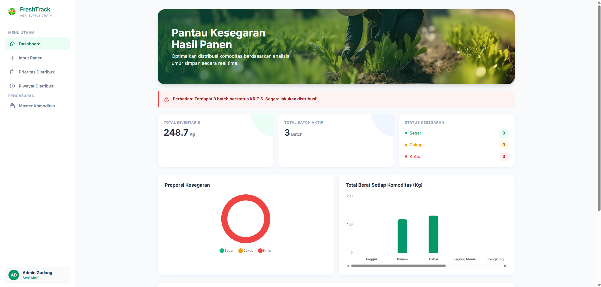
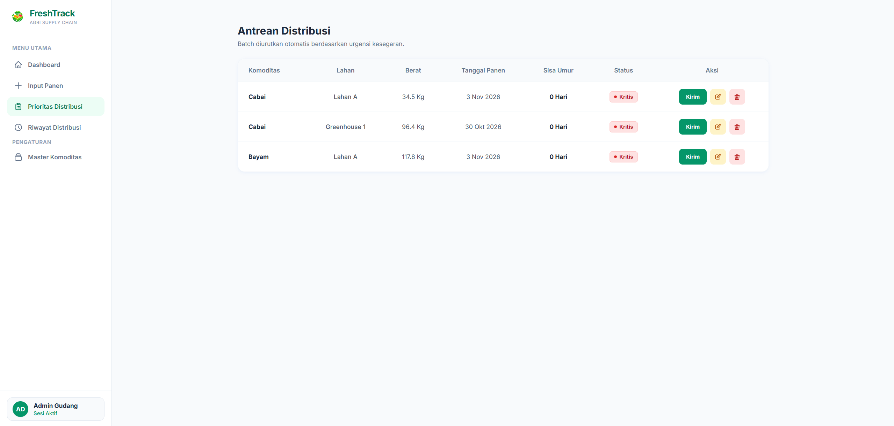
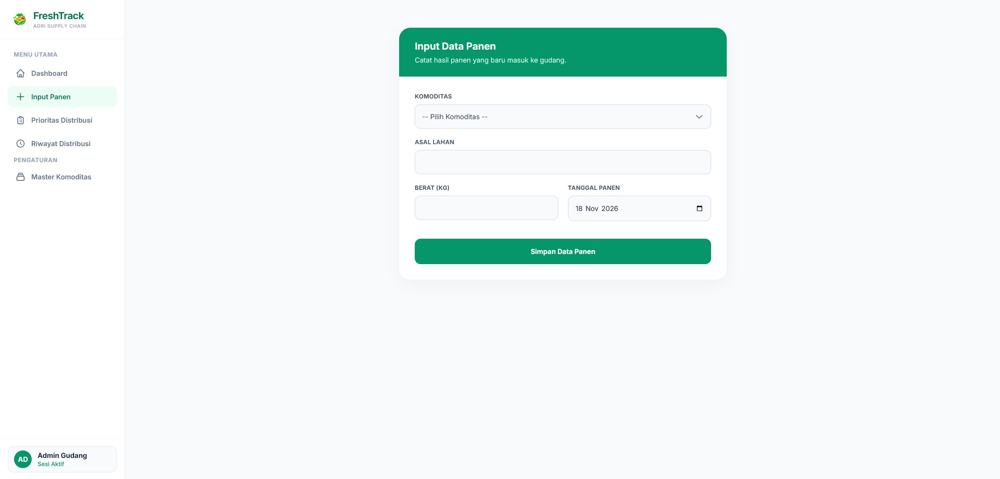
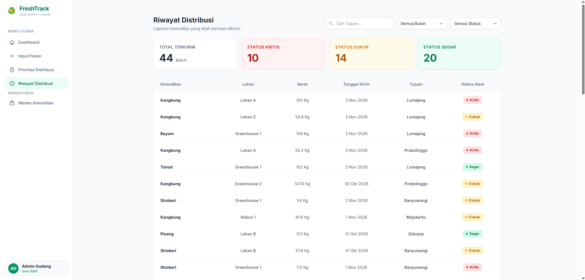
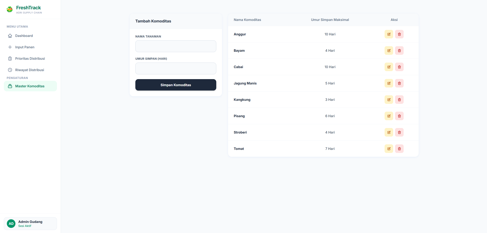

# FreshTrack: Sistem Manajemen Inventaris & Distribusi Pertanian

**FreshTrack** adalah aplikasi berbasis web yang dirancang untuk membantu proses bisnis pertanian industri, khususnya dalam mengelola hasil panen, memantau tingkat kesegaran komoditas, memprioritaskan distribusi berdasarkan sisa umur simpan, dan mencatat riwayat pengiriman secara akurat.

Aplikasi ini dikembangkan sebagai pemenuhan **Final Project Mata Kuliah Pemrograman Fungsional** menggunakan **Scala 3** dengan framework **Cask** pada sisi backend, serta HTML, Tailwind CSS, jQuery, dan Chart.js pada sisi frontend.

---

## Fitur Utama

1. **Dashboard Interaktif**  
   Menampilkan ringkasan total berat hasil panen, jumlah batch, status kesegaran (Segar, Cukup, dan Kritis), serta grafik distribusi komoditas.

2. **Manajemen Komoditas**  
   Fitur CRUD (Create, Read, Update, Delete) untuk mengelola daftar komoditas beserta standar umur simpannya.

3. **Input Hasil Panen**  
   Mencatat hasil panen baru yang secara otomatis menghitung sisa umur simpan dan status kesegaran berdasarkan tanggal panen.

4. **Sistem Prioritas Distribusi**  
   Mengurutkan daftar batch yang belum dikirim berdasarkan tingkat urgensi, mulai dari Kritis, Cukup, hingga Segar, serta berdasarkan sisa umur simpan terpendek.

5. **Pengiriman & Riwayat**  
   Mencatat proses pengiriman barang ke lokasi tujuan dan menyediakan halaman riwayat yang dilengkapi filter berdasarkan bulan, status kesegaran, dan tujuan pengiriman.

---

## Tampilan Antarmuka (Screenshots)

### 1. Dashboard Utama

Menampilkan metrik gudang dan grafik distribusi komoditas secara interaktif.



### 2. Daftar Prioritas Pengiriman

Menampilkan daftar batch komoditas yang diurutkan secara otomatis berdasarkan tingkat urgensi distribusi.



### 3. Input Hasil Panen

Formulir untuk menambahkan data hasil panen baru ke dalam sistem.



### 4. Riwayat Pengiriman

Menampilkan riwayat pengiriman komoditas beserta informasi tujuan dan status kesegarannya.



### 5. Manajemen Komoditas

Halaman untuk mengelola daftar komoditas dan mengatur standar umur simpannya.



---

## Teknologi yang Digunakan

| Teknologi | Keterangan |
|---|---|
| Scala 3 | Bahasa pemrograman backend |
| Cask | Framework HTTP Server dan Routing |
| PostgreSQL | Database relasional |
| HTML5 | Struktur halaman frontend |
| Tailwind CSS | Styling dan desain antarmuka |
| JavaScript | Logika interaksi frontend |
| jQuery | Manipulasi DOM dan AJAX |
| Chart.js | Visualisasi data dalam bentuk grafik |
| sbt | Scala Build Tool |
| MUnit | Framework unit testing |

---

## Implementasi Konsep Pemrograman Fungsional

FreshTrack dirancang dengan memisahkan logika fungsional murni pada `Logic.scala`, antarmuka web pada `Routes.scala`, serta operasi I/O database pada `Database.scala`.

Berikut merupakan implementasi konsep Pemrograman Fungsional yang diterapkan dalam sistem:

| Konsep FP | Implementasi |
|---|---|
| **Pure Function (6+)** | `hitungSisaUmur`, `tentukanStatus`, `rekapStatus`, `hitungTotalBerat`, `filterBatchKritis`, dan `validasiPengiriman` pada `Logic.scala`. |
| **Immutability (3+)** | Menggunakan `case class` sebagai model data, yaitu `Komoditas`, `Panen`, `Batch`, dan `Pengiriman` pada `Models.scala`. |
| **First-Class Function** | Menyimpan fungsi ke dalam nilai atau variabel, seperti `val aturanStandar: Int => StatusKesegaran = ...`, kemudian memasukkannya ke dalam Map melalui `aturanStatusMap`. |
| **Lambda Expression (2+)** | Menggunakan ekspresi lambda pada operasi koleksi, seperti `filter(b => !b.sudahDikirim)` dan `map((status, daftar) => ...)`. |
| **Higher-Order Function** | Fungsi `prosesSemuaBatch[A](batches: List[Batch])(f: Batch => A)` yang menerima fungsi lain sebagai parameter. |
| **Function Composition** | Menggunakan `.andThen` pada `fungsiHitungSisa.andThen(aturanTerpilih)` untuk menggabungkan fungsi. |
| **Function Chaining** | Rangkaian operasi pada `ambilPrioritasUtama`, seperti `.filter(...).sortBy(...).take(jumlah)`. |
| **Operasi Koleksi** | Menggunakan `.map`, `.filter`, `.groupBy`, `.partition`, dan `.foldLeft` pada Service dan Logic. |
| **Rekursi** | Menggunakan fungsi `@tailrec telusuriRiwayat(...)` dan `cariBatchTertua(...)` untuk melakukan pencarian data secara rekursif. |

---

## Struktur Folder

Proyek FreshTrack menggunakan struktur folder yang memisahkan frontend dan backend agar pengembangan lebih terorganisasi.

```text
FreshTrack/
├── frontend/
│   ├── images/
│   │   ├── banner-farm.jpg
│   │   ├── dashboard.png
│   │   ├── empty.png
│   │   ├── input-panen.png
│   │   ├── komoditas.png
│   │   ├── logo.png
│   │   ├── prioritas.png
│   │   ├── prioritas_pengiriman.png
│   │   └── riwayat.png
│   ├── index.html
│   └── script.js
│
├── backend/
│   ├── src/
│   │   ├── main/
│   │   │   ├── resources/
│   │   │   │   └── application.conf
│   │   │   └── scala/
│   │   │       ├── Main.scala
│   │   │       ├── Database.scala
│   │   │       ├── Models.scala
│   │   │       ├── Logic.scala
│   │   │       ├── Service.scala
│   │   │       └── Routes.scala
│   │   └── test/
│   │       └── scala/
│   │           └── LogicTest.scala
│   └── build.sbt
│
└── database.sql
```

### Penjelasan Struktur

- **frontend/**: Berisi antarmuka pengguna, file HTML, JavaScript, serta aset gambar.
- **backend/**: Berisi seluruh implementasi backend menggunakan Scala 3.
- **Main.scala**: Entry point untuk menjalankan server aplikasi.
- **Database.scala**: Mengelola koneksi database dan operasi SQL.
- **Models.scala**: Mendefinisikan model data menggunakan case class dan enum.
- **Logic.scala**: Berisi pure functions dan logika bisnis utama.
- **Service.scala**: Menjembatani Routes dengan Logic dan Database.
- **Routes.scala**: Mengelola endpoint API menggunakan Cask.
- **LogicTest.scala**: Berisi unit test untuk menguji logika fungsional.
- **application.conf**: Menyimpan konfigurasi aplikasi dan koneksi database.
- **database.sql**: Berisi skema database dan data awal.

---

## Cara Menjalankan Program

### 1. Prasyarat (Prerequisites)

Pastikan perangkat lunak berikut telah terinstal:

- **JDK (Java Development Kit)** versi 11 atau lebih baru.
- **sbt (Scala Build Tool)** versi 2.x.
- **PostgreSQL** beserta pgAdmin atau DBeaver.
- **Visual Studio Code** (opsional, untuk melihat dan mengedit kode).

### 2. Setup Database PostgreSQL

1. Buka PostgreSQL melalui pgAdmin atau aplikasi database lainnya.
2. Buat database baru dengan nama `DBFRESHTRACK`.
3. Buka file `database.sql`.
4. Jalankan seluruh query SQL di dalam file tersebut pada database `DBFRESHTRACK`.
5. Buka file konfigurasi:

   ```text
   backend/src/main/resources/application.conf
   ```

6. Sesuaikan konfigurasi database, terutama `db.user` dan `db.password`, dengan kredensial PostgreSQL pada komputer masing-masing.

### 3. Menjalankan Backend

1. Buka terminal pada direktori utama proyek FreshTrack.
2. Masuk ke direktori backend:

   ```bash
   cd backend
   ```

3. Jalankan server menggunakan sbt:

   ```bash
   sbt run
   ```

4. Tunggu hingga proses kompilasi dan server selesai dijalankan.

   Jika berhasil, server akan berjalan pada alamat:

   ```text
   http://localhost:8080
   ```

   > Proses pertama kali menjalankan sbt mungkin membutuhkan waktu lebih lama karena sbt perlu mengunduh dependensi proyek.

### 4. Membuka Aplikasi

Buka browser seperti Google Chrome, Microsoft Edge, atau Mozilla Firefox, kemudian akses:

```text
http://localhost:8080
```

---

## Menjalankan Unit Test

FreshTrack menyediakan unit testing menggunakan **MUnit** untuk memastikan logika fungsional berjalan sesuai dengan yang diharapkan.

Untuk menjalankan seluruh unit test, buka terminal pada direktori `backend`, kemudian jalankan:

```bash
sbt test
```

Perintah tersebut akan menjalankan seluruh pengujian yang terdapat pada direktori:

```text
backend/src/test/scala/
```

---

## Tim Pengembang

Proyek FreshTrack dikembangkan oleh mahasiswa kelas Pemrograman Fungsional.

| No. | Nama Lengkap | NIM |
|---:|---|---|
| 1 | Reloudryan Rosdi Al Rasyid | 252410103014 |
| 2 | Rizal Lazuardi | 252410103045 |
| 3 | Seto Aji | 252410103072 |
| 4 | Aji Pangestu | 252410103104 |

---

## Penutup

FreshTrack diharapkan dapat membantu meningkatkan efisiensi pengelolaan hasil panen dan distribusi komoditas pertanian melalui pencatatan inventaris yang terstruktur, pemantauan kesegaran komoditas, serta penentuan prioritas pengiriman berdasarkan sisa umur simpan.

Selain menjadi solusi dalam pengelolaan inventaris pertanian, proyek ini juga menjadi implementasi berbagai konsep Pemrograman Fungsional menggunakan Scala 3, khususnya pure function, immutability, higher-order function, function composition, operasi koleksi, dan rekursi.
